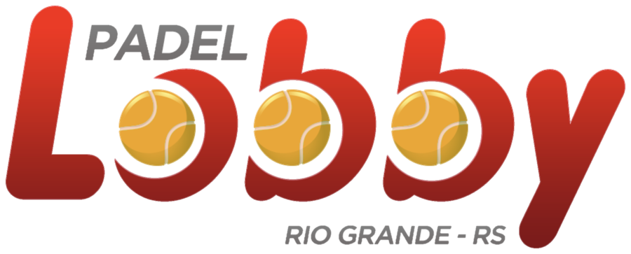
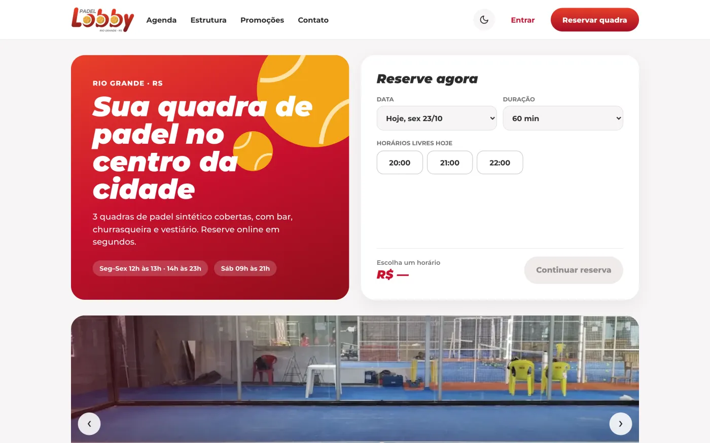
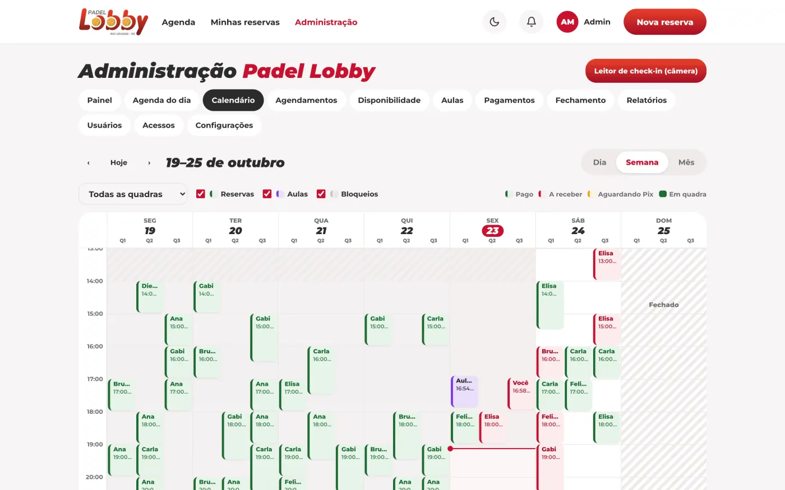
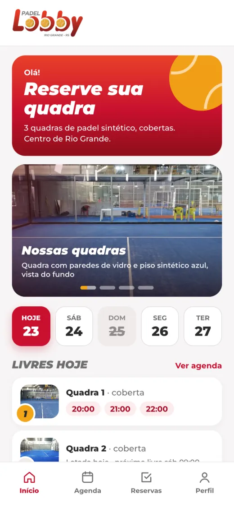
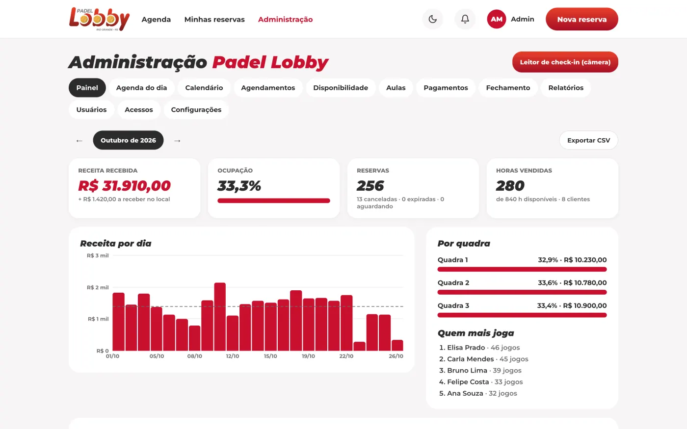
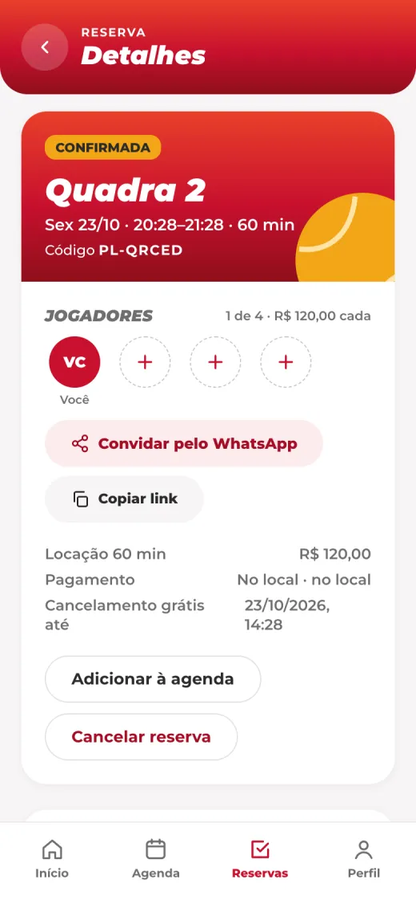
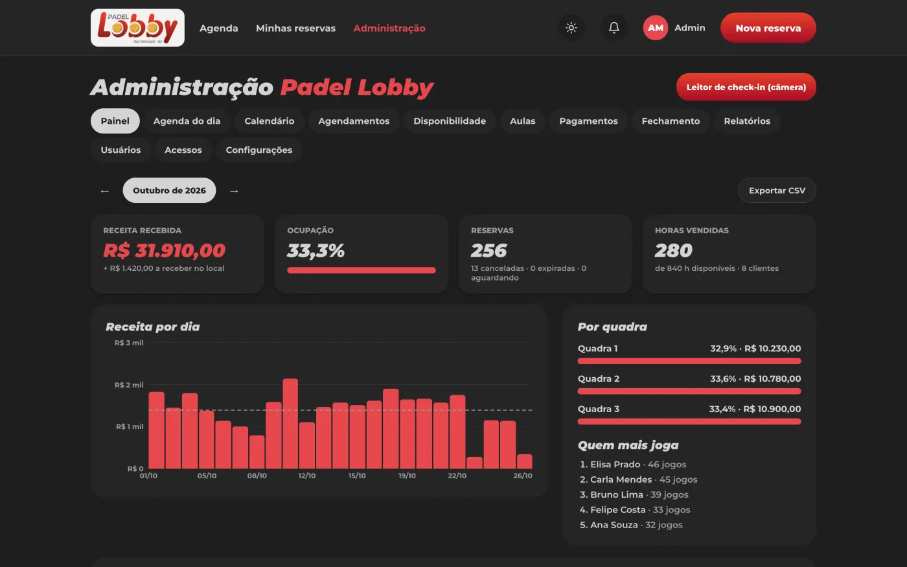
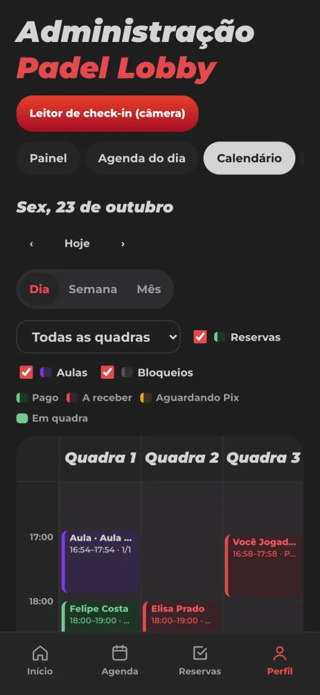
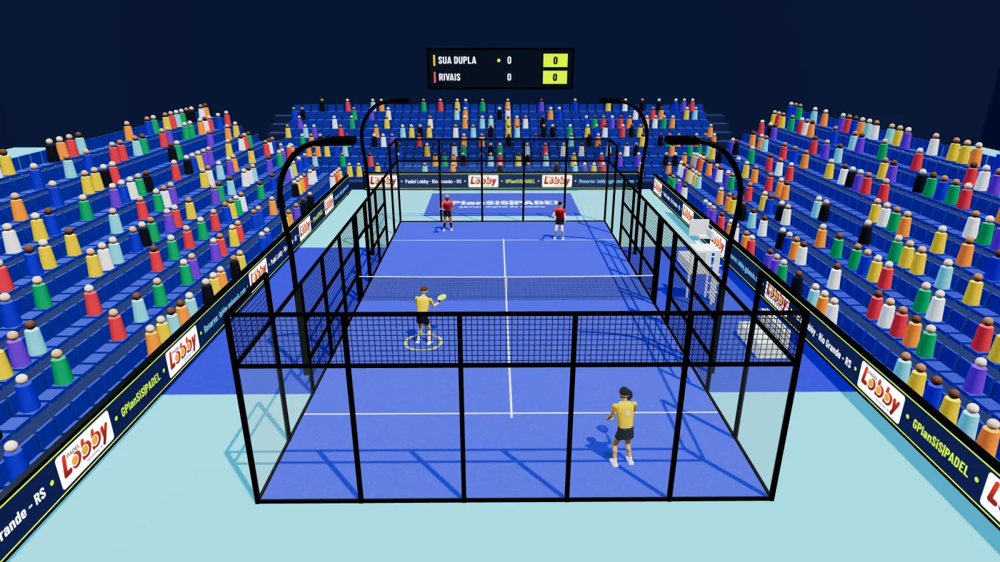
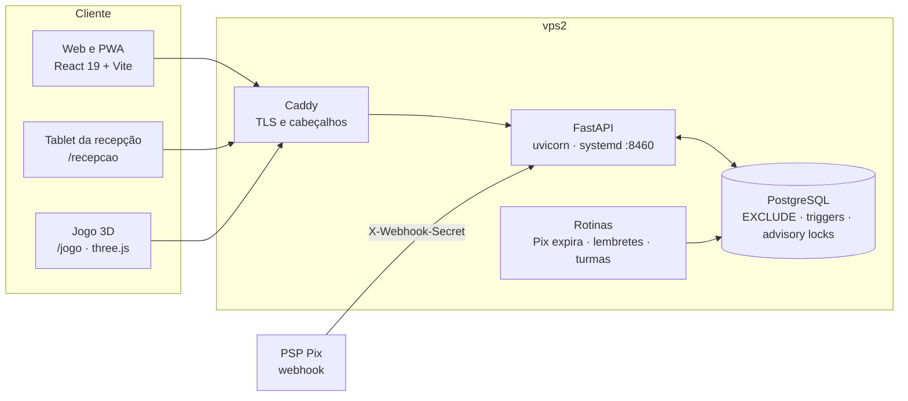

<div align="center">



# Padel Lobby — reservas, aulas e gestão do clube

Sistema completo do **Padel Lobby** (Rio Grande, RS): reserva de quadras com Pix, check-in por QR code,
aulas e alunos, área do professor, caixa diário, relatórios e um jogo de padel em 3D.

[](https://lobby.gplansis.com)
[](https://ssbianchiplan.github.io/lobby/)




</div>

---

## Sumário

- [Visão geral](#visão-geral)
- [Telas](#telas)
- [Arquitetura](#arquitetura)
- [Módulos](#módulos)
- [Regras de negócio e invariantes no banco](#regras-de-negócio-e-invariantes-no-banco)
- [API](#api)
- [Segurança e privacidade](#segurança-e-privacidade)
- [Rodando localmente](#rodando-localmente)
- [Testes e qualidade](#testes-e-qualidade)
- [Deploy](#deploy)
- [Estrutura do repositório](#estrutura-do-repositório)
- [Pendências](#pendências)

## Visão geral

| | |
|---|---|
| **Para o jogador** | Vê os horários livres, reserva em segundos (60 ou 90 min), paga por Pix, cartão ou no local, convida os parceiros pelo WhatsApp e faz check-in com QR code. |
| **Para o aluno e o professor** | Turmas, aulas particulares, chamada, mensalidades, QR pessoal de presença e uma área própria do professor. |
| **Para a recepção** | Leitor de QR por câmera (tablet), reserva de balcão, recebimentos, agenda do dia e calendário dia/semana/mês. |
| **Para a gestão** | Painel com gráficos interativos, fechamento de caixa com trava no banco, relatórios com CSV, usuários, log de acessos e de visitantes. |
| **Extra** | Jogo 3D **GPlanSiS\|PADEL** (`/jogo/`) com a quadra em escala real e o logo do clube nas placas de patrocínio. |

**Números:** cerca de 105 endpoints, 9 migrações SQL, 46 testes de integração e auditoria de responsividade em 29 telas × 7 larguras (360–1440 px).

## Telas

<table>
<tr>
<td width="68%"><br><sub><b>Calendário</b> — dia, semana e mês; clique no livre para reservar ou bloquear.</sub></td>
<td><br><sub><b>App no celular</b> — PWA com barra inferior.</sub></td>
</tr>
<tr>
<td><br><sub><b>Painel</b> — receita, ocupação e gráficos interativos.</sub></td>
<td><br><sub><b>Reserva</b> — jogadores, convite e QR de check-in.</sub></td>
</tr>
<tr>
<td><br><sub><b>Tema escuro</b> — paleta VS Code Dark, automático ou escolhido.</sub></td>
<td><br><sub><b>Admin no celular</b> — tabelas viram cartões.</sub></td>
</tr>
<tr>
<td colspan="2"><br><sub><b>Jogo 3D</b> — partida de duplas com treinador, replay e modo exploração (<code>/jogo/</code>).</sub></td>
</tr>
</table>

Mais telas na [página do projeto](https://ssbianchiplan.github.io/lobby/).

## Arquitetura



- **Um processo só**: a API serve o build do React (SPA com fallback e Open Graph gerado no servidor para convites) e os estáticos do jogo.
- **Regra crítica mora no banco**: sobreposição, capacidade, trava do caixa e máquina de estados são constraints e triggers, então nenhuma corrida entre requisições consegue furar.
- **Sessão** em JWT com `tv` (versão do token): trocar a senha, sair de todos os aparelhos ou ter a conta inativada derruba os tokens antigos.

| Camada | Stack |
|---|---|
| Banco | PostgreSQL 16+ (`btree_gist`, `pgcrypto`, `citext`) |
| API | Python 3.13 · FastAPI · asyncpg · Pydantic v2 · PyJWT · bcrypt |
| Web | React 19 · Vite 6 · TypeScript strict · TanStack Query 5 · React Router 7 |
| Jogo | three.js r128 local (sem CDN), HTML único com PWA própria |
| Infra | vps2 · systemd · Caddy · backups antes de cada migração |

## Módulos

### Reservas (jogador)

| Rota | O que faz |
|---|---|
| `/` | Dias com status real, livres por quadra, reserva rápida, carrossel de fotos das quadras, cards do torneio, do jogo 3D e do iaVision |
| `/agenda` | Grade quadra × hora com intervalo do almoço, 60/90 min |
| `/agenda/confirmar` | Jogadores, Pix / cartão / no local, preço por jogador |
| `/reservas`, `/reservas/:code` | Próxima reserva com QR de check-in (cartão em imagem para baixar ou compartilhar), histórico, “Repetir”, `.ics` |
| `/convite/:token` | Convite pelo WhatsApp com prévia (Open Graph) da quadra, do horário e das vagas |
| `/cadastro`, `/perfil` | Conta com termos/LGPD, perfil de jogador, estatísticas, parceiros, exportar dados, excluir (anonimiza) |

### Administração (`/admin`)

| Aba | O que faz |
|---|---|
| Painel | Receita, ocupação, horas vendidas, receita por dia (clique abre o dia no Calendário), por quadra, ranking |
| Agenda do dia | Reservas e aulas do dia, check-in por código, bloqueios |
| Calendário | Dia (quadras em colunas, tempo passado sombreado, prévia ao passar o mouse), Semana e Mês; aceita `?dia=&visao=` |
| Agendamentos | Todas as reservas com filtros, busca, totais e CSV |
| Disponibilidade | Grade quadras × 30 min (1, 3 ou 7 dias); reservar em nome de cliente ou bloquear direto pelo modal |
| Aulas | Professores, turmas, particulares, matrículas, chamada, mensalidades |
| Pagamentos | A receber, recebimentos por forma, estornos, CSV |
| Fechamento | Caixa do dia: esperado × contado, sobra/falta, fechar/reabrir com motivo, impressão |
| Relatórios | Por dia, quadra, dia da semana, horário, cliente, forma e duração; CSV e impressão |
| Usuários | Ficha em modal, criar (senha temporária), inativar/reativar, excluir; **Manual do sistema** (só admin) |
| Acessos | Log de acessos (logins, falhas, bloqueios) e visitantes do site, com gráficos |
| Configurações | Preços por faixa, feriados, regras, fotos das quadras, limpar dados de exemplo (só master) |

**Admin master** (`PADEL_MASTER_ADMINS`): sempre administrador, não pode ser rebaixado e é o único que promove ou rebaixa
admins. A conta nasce no servidor com `python -m app.cli master`, que o deploy já roda, e nunca pela tela de cadastro.

### Check-in por QR code

O tablet da recepção abre `/recepcao` e lê três tipos de QR com a câmera (`BarcodeDetector` nativo ou `jsQR` no Safari):

| QR | Efeito |
|---|---|
| Reserva `…/checkin/PL-XXXXX` | Check-in da quadra (abre 1 h antes) |
| Aluno `…/aluno/<token>` | Presença na aula de agora |
| Professor `…/professor/<token>` | Registra a chegada e **inicia a aula** |

Retorno grande na tela, bipe, vibração e tela sempre acesa. Lido pela câmera comum do celular, o link leva o jogador à
reserva e mostra ao admin um botão de confirmação.

### Aulas, alunos e área do professor

- Turmas recorrentes com calendário gerado 4 semanas à frente e renovado todo dia; dias fechados e quadras ocupadas são pulados e avisados.
- Chamada (presente a partir de 1 h antes), aluno avulso gera a cobrança da aula avulsa, mensalidades sem duplicar e no mesmo caixa.
- `/professor`: aulas de hoje com **Iniciar aula**, chamada, anotações, agenda, turmas e alunos com frequência — sem valores financeiros.

### Jogo 3D GPlanSiS|PADEL (`/jogo/`)

Gêmeo digital da quadra 20 × 10 m (vidro, grade, rede em escala) com partida de duplas contra a máquina, treinador
**Fabricio Correia**, replay, telemetria e modo exploração com as medidas oficiais. As placas de publicidade levam o logo
do Padel Lobby. No celular: joystick e botões de golpe, menu ☰, golpe automático por padrão e tela cheia.
Ao alterar o jogo, troque `VERSION` em `frontend/public/jogo/sw.js`.

### PWA, tema e responsividade

- Instalável (manifest, ícones *maskable*, service worker que guarda a casca; a API nunca é cacheada).
- Tema claro e escuro por tokens CSS; áreas seguras do iPhone e do Android; campos de 16 px no celular para o iOS não dar zoom.
- Modais com `<dialog>` nativo (Esc, foco preso, folha inferior no celular), sem nenhum `window.confirm`.

## Regras de negócio e invariantes no banco

| Regra | Onde é garantida |
|---|---|
| Sem reserva sobreposta na mesma quadra | `EXCLUDE USING gist (court_id WITH =, period WITH &&)` (há teste com 6 requisições concorrentes) |
| Aula × reserva × bloqueio nunca se cruzam | Triggers com *advisory lock* por quadra, nos dois sentidos (migração 005) |
| Turma não passa da capacidade | Trigger em matrículas |
| Caixa fechado não aceita recebimento de balcão | Trigger em `payments`; Pix e cartão online entram como “movimento após o fechamento” |
| Estados `pending → confirmed → checked_in → completed` (+ `cancelled`/`expired`) | Trigger de transição, com trilha em `reservation_events` |
| Até 4 jogadores por reserva | Trigger |

- **Funcionamento**: seg–sex 12–13 h e 14–23 h, sáb 9–21 h, dom fechado; feriado aberto usa o horário de sábado; 90 min não atravessa o intervalo.
- **Preço por faixa**, calculado a cada 30 min (promocional, nobre, fim de semana/feriado), editável em *Configurações*.
- **Pix**: BR Code EMV com CRC16 e txid; o horário fica seguro por 15 min e expira sozinho. Webhook idempotente.
- **Cancelamento** grátis até 6 h antes (configurável); limite de 3 reservas futuras e janela de 14 dias para o jogador.

## API

Documentação interativa em `/docs` (Swagger) quando a API roda localmente.

| Grupo | Prefixo | Endpoints |
|---|---|---|
| Agenda e clube | `/api/club`, `/api/availability`, `/api/calendar`, `/api/quote` | 4 |
| Conta e sessão | `/api/auth`, `/api/me` | 8 |
| Reservas, convites e Pix | `/api/reservations`, `/api/invites`, `/api/payments`, `/api/notifications` | 13 |
| Aulas | `/api/admin/class-groups`, `/api/admin/class-sessions`, `/api/admin/enrollments`, `/api/admin/coaches`, `/api/me/classes`… | 29 |
| Professor | `/api/coach` | 8 |
| Admin | `/api/admin` | 17 |
| Retaguarda (caixa, relatórios, usuários) | `/api/admin` | 23 |
| Logs | `/api/track`, `/api/admin/logs` | 3 |

## Segurança e privacidade

- Senhas com bcrypt; login trava 5 min após 5 erros no mesmo e-mail; senha temporária com troca obrigatória.
- `token_version` no JWT derruba sessões antigas (troca de senha, “sair de todos”, inativação, exclusão).
- Fallback da SPA com `resolve()` + `is_relative_to` contra *path traversal* (com teste de regressão).
- Webhook Pix autenticado por `X-Webhook-Secret` e idempotente.
- **LGPD**: exclusão de conta anonimiza nome, e-mail e telefone e mantém o histórico financeiro sem identificação; o usuário exporta os próprios dados em JSON.
- **Visitantes** anônimos: IP truncado, tokens removidos das URLs, respeito ao *Do Not Track*, robôs marcados; retenção de 180 dias (visitas) e 365 dias (acessos).

## Rodando localmente

```bash
# 1. Banco (uma vez)
sudo -u postgres psql -c "CREATE ROLE padel LOGIN PASSWORD 'padel' CREATEDB;" -c "CREATE DATABASE padel_lobby OWNER padel;"
sudo -u postgres psql -d padel_lobby -c "CREATE EXTENSION btree_gist; CREATE EXTENSION pgcrypto; CREATE EXTENSION citext;"

# 2. API
cd backend
python3 -m venv .venv && .venv/bin/pip install -r requirements.txt
.venv/bin/python seed.py              # migrações + configuração + dados de exemplo
.venv/bin/uvicorn app.main:app --reload --port 8000

# 3. Web (outro terminal)
cd frontend && npm install && npm run dev   # http://localhost:5173
```

Contas de exemplo (só no banco local criado pelo `seed.py`): `jogador@padellobby.com.br` / `jogador123` e
`admin@padellobby.com.br` / `admin123`. Em produção, o master apaga esses dados em *Configurações › Limpar dados de exemplo*.

Com Docker: `JWT_SECRET=... PIX_WEBHOOK_SECRET=... docker compose up --build` (a API serve o build do React em `:8000`).

## Testes e qualidade

```bash
cd backend && .venv/bin/pytest        # 46 testes de integração contra o banco padel_lobby_test
cd frontend && npx tsc -b && npm run build
```

Os testes cobrem concorrência de reservas, Pix e webhook, fechamento de caixa, check-in, aulas e capacidade, área do
professor, usuários e logs. Antes de cada deploy roda uma auditoria Playwright de responsividade (29 telas × 7 larguras,
sem rolagem lateral nem texto vazando).

## Deploy

Produção: **https://lobby.gplansis.com** (vps2, venv + systemd + Caddy).

```bash
bash deploy/vps/enviar.sh               # build, rsync, migra, garante o master, reinicia e verifica
bash deploy/vps/enviar.sh --so-codigo   # só build + rsync + restart
```

As migrações (`backend/migrations/001…009`) são aplicadas na subida. Antes de uma migração, faça backup do banco
em `/var/backups/padel-lobby/`.

## Estrutura do repositório

```
backend/
  app/
    main.py            # app, SPA, estáticos do jogo
    routers/           # auth, club, bookings, admin, backoffice, classes, coach, logs
    preview.py         # Open Graph dos convites
    audit.py           # log de acessos e visitantes
    static/manual.html # manual do sistema (só admin)
  migrations/          # 001_init … 009_logs
  tests/
frontend/
  src/pages/           # telas do jogador, professor e admin/
  src/components/      # BarChart, Modal, Ticket, Theme, cards da home…
  public/jogo/         # jogo 3D GPlanSiS|PADEL
  public/quadras/      # fotos das quadras (WebP)
deploy/vps/            # enviar.sh, systemd, Caddy
docs/                  # página do projeto (GitHub Pages)
```

## Pendências

- Pix e cartão reais exigem um PSP/gateway; o ponto de integração é o webhook `POST /api/payments/pix/webhook`.
- Telefone do WhatsApp do clube: configurar em *Admin › Configurações*.
- Envio de e-mail (hoje a recuperação de senha é pela recepção, com senha temporária).

---

<div align="center">
<sub>Desenvolvido por <a href="https://gplansis.com">GPlanSiS|Group</a> · Padel Lobby, Rio Grande – RS</sub>
</div>
